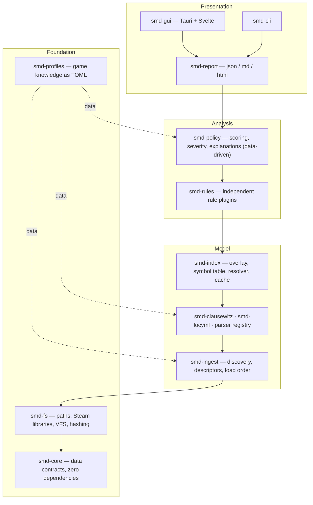

# 01 — System overview

## What the program is

A local desktop application that answers one question well:

> **When these mods are loaded in this order, what does each one take away from the
> others, and which of those takings are likely to matter?**

It is a *diagnostic instrument*, not a fixer. v1 never edits a mod. It observes,
explains, and ranks.

## What it is not

- Not a mod manager. It does not install, subscribe, or launch.
- Not a validator. It does not check whether a mod is internally correct; CWTools
  already does that better.
- Not an oracle. It cannot run the game's loader, so every output is an *inference*
  with a stated basis. The UI language reflects this — findings say "this mod's
  definition of X is discarded", never "this mod is broken".

## The five questions the engine answers

| # | Question | Layer that answers it |
| --- | --- | --- |
| 1 | Which mods ship a file at the same path? | File overlay |
| 2 | Which mods define the same named game object? | Symbol index |
| 3 | Which mods define the same localisation key or event id? | Symbol index (other domains) |
| 4 | Given the load order, which definition survives? | Resolver |
| 5 | Is that survival harmless, suspicious, or destructive? | Rule engine + policy |

Question 5 is the entire value of the tool. Questions 1–4 are mechanical; anyone can
compute them. Distinguishing an intentional overhaul overwrite from a silent breakage is
the hard part and the thing the architecture is bent around.

## Layer stack

Dependencies point **downward only**. `smd-core` depends on nothing but `std`. This is
enforced by a CI crate-graph test, not by convention (§ `12-testing.md`).

## The three extension seams

Everything the roadmap wants to add later enters through one of exactly three seams.
Nothing else in the system needs to change.

| Seam | Add by | Example future work |
| --- | --- | --- |
| **Parser** | implement `FileParser`, self-register | Lua parsing for Factorio; `.asset` files |
| **Rule** | implement `Rule`, self-register | orphan-reference detection; patch-mod matching |
| **Game profile** | drop in a TOML file | CK3, EU4, Victoria 3; a non-Paradox Steam game |

A new *severity weighting* is a data edit. A new *report format* is one renderer impl.
A new *GUI panel* is one Svelte module plus one route entry. None of these touch the
engine.

## End-to-end flow, one sentence per stage

1. **Discover** — find the game install, the Steam library roots, the mod directories,
   and the active playset.
2. **Resolve order** — turn the playset into a deterministic `Vec<SourceId>` where later
   index = higher precedence.
3. **Enumerate** — walk every active mod, normalise relative paths, classify each file,
   hash it.
4. **Overlay** — compute, per path, the ordered list of contributing mods and the winner;
   apply `replace_path` directory shadowing.
5. **Parse** — for each text file, emit a flat stream of `Fact`s (definitions, references,
   loc keys, namespaces, defines).
6. **Index** — fold facts into a symbol table keyed by `(domain, symbol)`, plus reverse
   indices.
7. **Analyse** — run every enabled rule over the immutable index; each emits `Finding`s.
8. **Score** — the policy layer turns rule outputs into a score and severity band.
9. **Present** — sort deterministically, paginate, render.

Stages 3–7 are the pipeline described in `04-process-architecture.md`. Stages 1–2 are
cheap and sequential. Stages 8–9 are pure functions over the finding set.

## Prior art, and what we take from it

| Tool | Take | Leave |
| --- | --- | --- |
| **Irony Mod Manager** (C#/Avalonia) | Conflict-solver UX, patch-mod generation as an eventual goal, proof that Avalonia works here | Coupling analysis to mod management; we stay read-only |
| **CWTools** (F#, LSP + validator) | Its `.cwt` config files encode Stellaris's type system declaratively — a candidate data source for our domain map instead of hand-writing it (**check licence before vendoring**) | Full semantic validation; out of scope |
| **Paradox launcher** | The playset/load-order source of truth | Its notion that load order is a user problem |
| **`ck3-tiger` / `tiger` family** | Error-catalogue design; per-check ids and suppressions | Single-mod focus |

The gap none of them fill, and the one this tool aims at: a **cross-mod, whole-playset,
ranked diagnosis** that a player can read without knowing what a scripted trigger is.

## Guiding principles

1. **Read-only by default.** The tool never writes into game or mod directories. Any
   future mutation (patch generation, load-order rewrite) is a separate, explicit,
   backed-up command.
2. **Domain knowledge lives in data.** Folder semantics, severities, and explanation text
   are TOML. A Stellaris patch that adds `common/new_thing/` should be a data PR.
3. **Never abort a scan.** A malformed file produces a `Diagnostic` and the scan
   continues. One broken mod must not blind the user to the other 299.
4. **Deterministic output.** Same inputs, same bytes out — reports are diffable and
   snapshot-testable.
5. **Explain the basis.** Every finding carries the evidence that produced it and a
   plain-language reason. A finding the user cannot verify is a bug.
