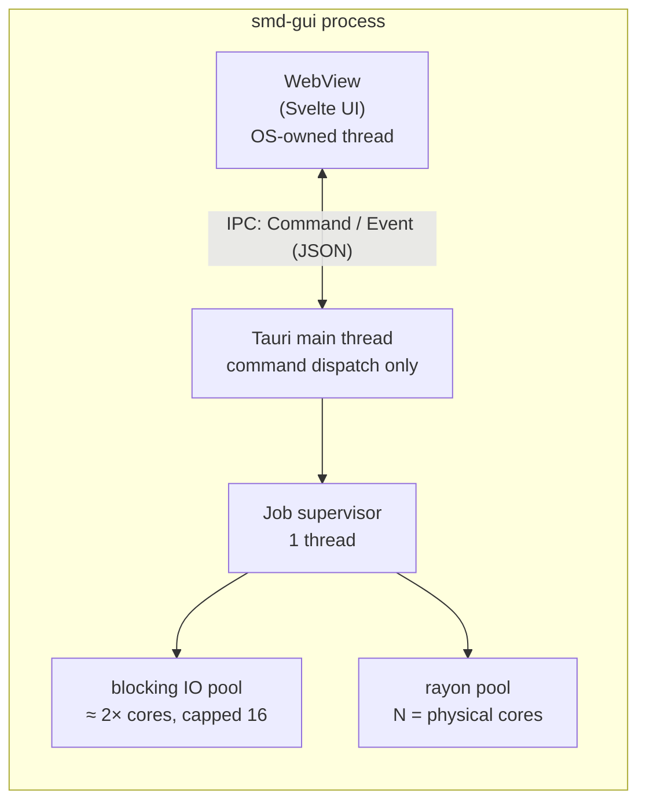
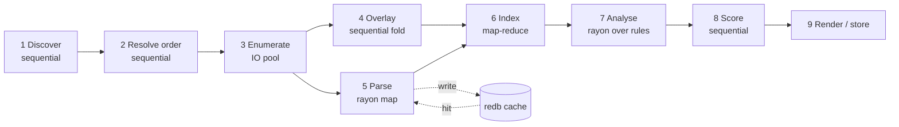
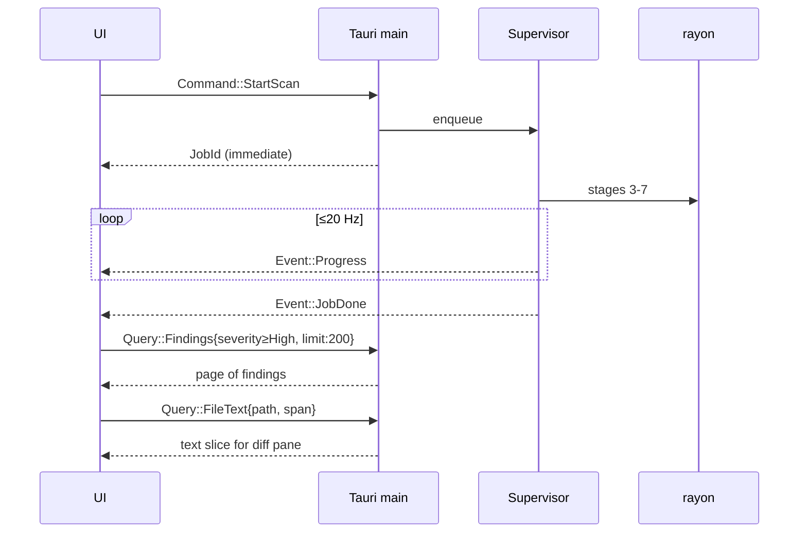

# 04 — Process architecture

How the program actually runs: processes, threads, stages, channels, cancellation,
and the boundary between engine and UI.

## Process topology

**One process.** The engine is a library linked into the GUI binary and into the CLI
binary; it is not a service, not a daemon, and not a sidecar.



### Why not a separate engine process

Considered and rejected. A sidecar buys crash isolation, but a scan produces on the
order of 10<sup>6</sup> facts and 10<sup>5</sup> findings; serialising that across a pipe
would cost more than the parsing does. Crash isolation is bought more cheaply by
(a) never panicking on input — parse errors are `Diagnostic`s, and (b)
`catch_unwind` around each rule so one bad rule fails alone.

The one thing that *does* get its own process is the optional **Steam Workshop metadata
fetch** (`smd-net`, post-v1), because it touches the network and should be killable and
sandboxable independently.

### Thread inventory

| Thread(s) | Count | Blocking allowed | Purpose |
| --- | --- | --- | --- |
| WebView | OS-managed | n/a | UI rendering |
| Tauri main | 1 | **no** | Receives commands, forwards to supervisor, returns immediately |
| Supervisor | 1 | yes | Owns job lifecycle, stage wiring, progress aggregation |
| IO pool | min(2×cores, 16) | yes | `readdir`, `stat`, `mmap`, hashing |
| Rayon pool | physical cores | **no** | Parse, index-merge, analyse |
| Cache writer | 1 | yes | Batched `redb` commits, off the critical path |

The main thread never does work. A command handler that takes more than a millisecond is
a bug — it must hand off to the supervisor and return a `JobId`.

## The scan pipeline



Stage-by-stage concurrency strategy:

| Stage | Model | Notes |
| --- | --- | --- |
| 1 Discover | sequential | Milliseconds. Reads registry/vdf/launcher DB. |
| 2 Resolve order | sequential | Assigns `SourceId`s. Pure function of the playset. |
| 3 Enumerate | `jwalk` parallel walk on the IO pool | Emits `FileEntry` batches into a bounded channel |
| 4 Overlay | single-threaded fold over entries sorted by `PathId` | Cheap; ordering makes it trivially deterministic |
| 5 Parse | `rayon::par_iter` over text files | **Cache-checked first**; each worker owns an arena |
| 6 Index | map-reduce: per-worker local maps, then a parallel merge | No shared locks anywhere in the hot path |
| 7 Analyse | `rayon::par_iter` over *rules* | Index is immutable and shared by `&`; each rule writes its own `Vec<Finding>` |
| 8 Score | sequential | Microseconds. Table lookups. |
| 9 Render | sequential, or streamed for HTML | Deterministic sort applied here |

### Why map-reduce for indexing rather than a sharded concurrent map

A `DashMap` sharded by symbol hash was the obvious choice and is the wrong one here:
the fact stream is *bursty and skewed* (one huge `00_species_traits.txt` produces
thousands of facts for one domain), so shard contention spikes exactly when throughput
matters. Per-worker local `FxHashMap`s merged pairwise at the end have no contention at
all, and the merge is itself parallel over disjoint key ranges. Cost is transient memory
during the merge, which the budget accommodates.

### Backpressure

Every inter-stage channel is bounded (`crossbeam::bounded(1024)` of *batches*, not
items). Enumeration on a fast NVMe outruns parsing; without bounds the file list would
materialise entirely in memory before parsing starts, spiking RSS. Bounded channels make
the pipeline self-throttling and keep peak memory proportional to the window, not to the
corpus.

Batching matters as much as bounding: items move in `Vec` batches of ~256 so channel
overhead stays under a percent of runtime.

## Job model

Every long operation is a `Job`. The UI never blocks.

```rust
pub struct JobId(u64);

pub enum JobState { Queued, Running { stage: Stage, pct: f32 }, Done, Failed, Cancelled }

pub trait Job: Send {
    fn run(&mut self, ctx: &JobCtx) -> Result<JobOutput, JobError>;
}

pub struct JobCtx {
    cancel:   CancellationToken,
    progress: ProgressSink,
}
```

- **Cancellation** is cooperative and checked at every batch boundary — worst-case
  latency is one batch, single-digit milliseconds. `Drop` on the token cancels children.
- **Progress** is coalesced: workers bump an atomic counter, and the supervisor emits at
  most **20 events/second**. Uncoalesced per-file progress events would flood the IPC
  channel and make the UI slower than the scan.
- **Only one scan job runs at a time**; a second request supersedes the first
  (cancel-then-start). Query jobs run concurrently and freely.

## Engine ⇄ UI boundary (`smd-api`)

Three enums, and nothing else crosses:

```rust
pub enum Command { StartScan(ScanRequest), Cancel(JobId), SetLoadOrder(Vec<ModKey>), Export(ExportRequest) }

pub enum Query   { Summary, Findings(FindingQuery), Symbol(SymbolRef), FileText(FileRef), ModDetail(ModKey) }

pub enum Event   { Progress(JobId, Stage, f32), JobDone(JobId), Diagnostic(Diagnostic), ScanInvalidated }
```

Four rules govern this boundary:

1. **Findings are paginated.** `FindingQuery` carries filter + sort + `offset` + `limit`
   (default 200). A 300-mod playset can produce >100k findings; shipping them all into
   JS would freeze the WebView. The engine holds the truth; the UI holds a window.
2. **Types are generated, never hand-written.** `ts-rs` emits `ui/src/lib/api/types.ts`
   from the Rust definitions; CI fails if the checked-in file differs from the generated
   one. Two hand-maintained copies of a schema always drift.
3. **File text is fetched on demand.** The diff view asks for exactly the byte ranges it
   is about to display.
4. **Queries are pure.** A `Query` never mutates engine state, so it can be served from
   any thread against the immutable index.

### Sequence of a typical interaction



## Failure policy

| Failure | Handling |
| --- | --- |
| Unreadable file | `Diagnostic::Warn`, skip file, continue |
| Malformed script | `Diagnostic::Warn` at the offending span, keep the facts parsed so far |
| Missing mod directory referenced by the playset | `Diagnostic::Error`, mod marked `Unresolved`, scan continues |
| Rule panics | `catch_unwind`, that rule's findings dropped, `Diagnostic::Error` naming the rule |
| Cache corrupt / version mismatch | Delete and rebuild silently |
| Launcher DB locked (game running) | Copy to temp, read the copy, note it in the report |
| Out of memory | Not handled gracefully; prevented by the budget in `11-performance.md` |

The scan exits non-zero from the CLI only on `Error`-class diagnostics or an internal
failure — **never** because conflicts were found. Conflicts are the expected output.
(`--fail-on critical` exists for CI users who want the other behaviour.)

## Determinism

Reproducibility is a testability requirement, not a nicety, because snapshot tests
depend on it. Parallelism is introduced only where results are order-independent:

- Parse output is keyed by `(SourceId, PathId)` and sorted before indexing.
- Index merge is commutative; ties resolve by `SourceId` (load order), which is total.
- Findings sort by `(severity desc, rule, subject, first participant SourceId)`.
- No `HashMap` iteration order ever reaches output; `BTreeMap` or explicit sorts only.

`cargo test --features determinism-check` runs a scan twice with different thread counts
and asserts byte-identical reports.
