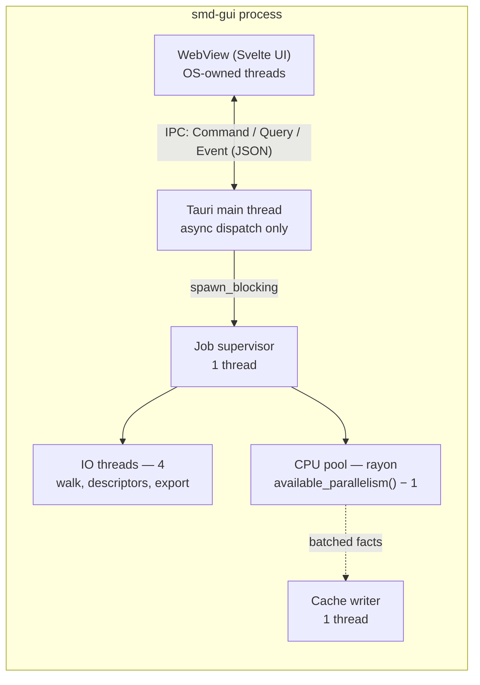
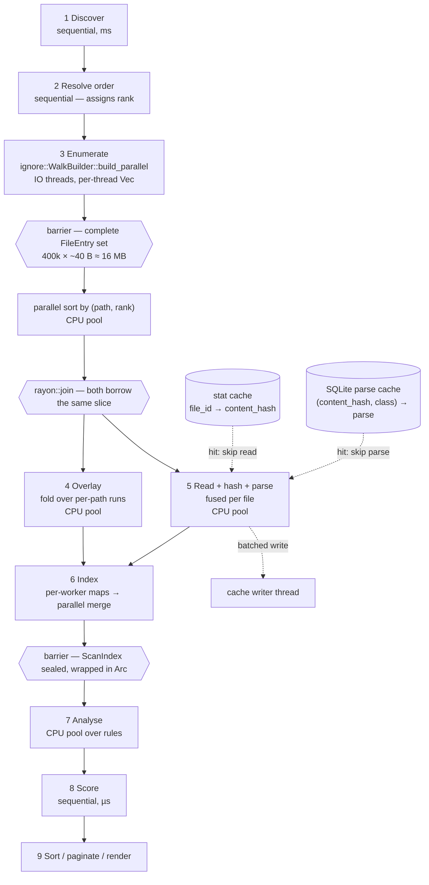
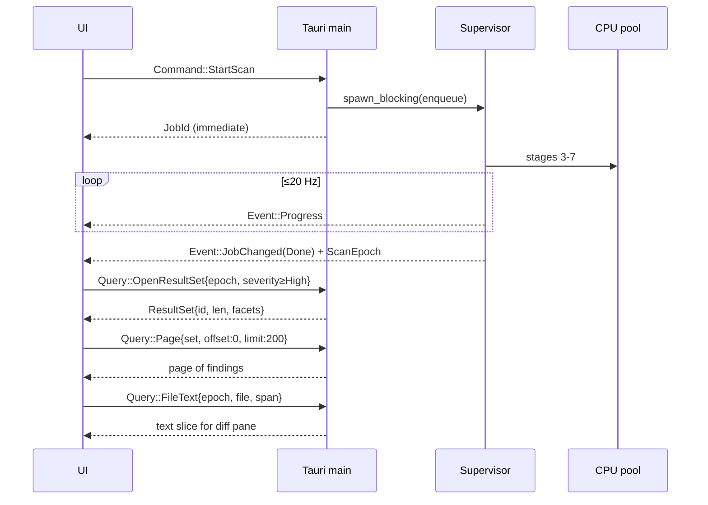

# 04 — Process architecture

How the program actually runs: processes, pools, stages, barriers, cancellation, and the
boundary between engine and UI.

## The scheduling invariant

Everything below is designed to one rule, and every departure from the obvious streaming
design is there to keep it true:

> **Invariant C1:** No stage may block on a channel while occupying a worker of a pool
> another stage needs in order to make progress.

Three consequences shape the whole pipeline:

- **Channels never feed a parallel stage.** A parallel stage consumes a materialised
  slice, never a receiver. The one adapter that bridges the two (`rayon`'s `par_bridge`)
  parks the worker that calls it until the sender produces; a pool full of bridges is a
  pool waiting on producers that have no worker left to run on. `par_bridge` is banned by
  lint, with that reason recorded at the lint site.
- **A stage that needs the complete set is a barrier, and is drawn as one.** Sorting by
  path, folding the overlay, and sealing the index are whole-set operations. Drawing them
  as streaming stages does not make them stream; it only hides where the pipeline stops.
- **The only wait permitted on the CPU pool is one whose releasers are already running.**
  The read-buffer semaphore below qualifies because it is sized so that a single worker
  can always acquire. A wait on work that has not been scheduled yet is a deadlock
  waiting for a thread count.

## Process topology

**One process.** The engine is a library linked into the GUI binary and into the CLI
binary; it is not a service, not a daemon, and not a sidecar.



In the CLI there is no WebView and no main thread to protect; the supervisor runs on the
process's main thread and the pools are identical. The pipeline is the same code.

### Why not a separate engine process

Considered and rejected. A sidecar buys crash isolation, but a scan produces on the order
of 10<sup>6</sup> facts and 10<sup>5</sup> findings; serialising that across a pipe would
cost more than the parsing does. Isolation is bought more cheaply, and more precisely, by
three things that also have to be true anyway:

1. **Input never panics.** Parse errors are `Diagnostic`s, and the parser is iterative
   with an explicit depth cap (§ `06`) so no input can exhaust the stack.
2. **`Rule::run` returns `Vec<Finding>`** (§ `08`). The unwind boundary is a value
   boundary, so `catch_unwind` is sound by type rather than by an `AssertUnwindSafe`
   whose precondition is convention. Rules hold no `std::sync::Mutex`, so a panic cannot
   poison state a later rule needs.
3. **`panic = "unwind"` is pinned** in the release profile and asserted by a profile-audit
   lint. Under `panic = "abort"` every isolation claim in this document is a no-op, and
   nothing else in the build would say so.

The residue is stated rather than papered over: a stack overflow, an allocation failure,
or an abort in a dependency still takes the process down. The depth cap is the mitigation
for the only one of those three that user input can reach.

The one thing that *does* get its own process is the optional **Steam Workshop metadata
fetch** (`smd-net`, post-v1), because it touches the network and should be killable and
sandboxable independently.

### Pools

Two pools, one of each kind, both owned by `smd-engine`.

| Pool | Size | Work | Why this size |
| --- | --- | --- | --- |
| **CPU** | `available_parallelism() − 1`, min 1 | hashing, parsing, overlay fold, index merge, rule execution, sorting, rendering | Leaves one core for the WebView and for the game the user may still have running. All of this work is compute; more threads than cores buys nothing and costs cache. |
| **IO** | 4 (configurable 2–8) | `readdir`/`stat` during the walk, descriptor reads, launcher-DB copy, export writes | These wait on the filesystem, not on the CPU. Four is enough to keep an NVMe queue busy and few enough that a network-mounted mod directory cannot spawn a thread storm. |

Plus three singletons: the Tauri main thread, the job supervisor, and the cache writer.
Peak on an 8-core box is **~14 threads**, and ~10 outside the walk.

`ignore::WalkBuilder::build_parallel` insists on spawning its own threads, so the IO
budget is a *policy* rather than a single shared pool object: the walker is constructed
with `.threads(io_threads)` and joined before stage 4, and the engine's own IO pool of
the same size serves everything outside stage 3. No IO thread is ever live at the same
time as the walker's.

> **Rule:** exactly one `Arc<rayon::ThreadPool>` exists, it is created by `smd-engine`,
> and every parallel entry point runs inside `pool.install(..)`. `cargo xtask lint` fails
> the build on `par_iter`, `par_bridge`, `rayon::scope`, or `rayon::spawn` appearing
> outside `smd-engine` (not yet built; gated H37, M2 — § `13` lint ledger). A bare `.par_iter()` elsewhere silently targets rayon's *global*
> pool — a third pool nobody budgeted, which would also make the varied-thread-count
> determinism test (§ `13`) meaningless.

### Thread priority

The tool runs on a gaming machine, frequently while the game or launcher is open.
Saturating every core at normal priority to answer a question about a game the user is
currently playing is the wrong default.

| Platform | Default | Mechanism |
| --- | --- | --- |
| Windows | below normal | `SetThreadPriority(THREAD_PRIORITY_BELOW_NORMAL)` on each pool thread at spawn |
| Linux | `nice +5` | `setpriority(PRIO_PROCESS, tid, 5)` per thread |
| macOS (deferred, owner decision 2026-10-29) | utility QoS | `pthread_set_qos_class_self_np(QOS_CLASS_UTILITY)` |

`--full-speed` (CLI) and a settings toggle (GUI) drop the adjustment for users who want
the machine's whole attention. The budget in `12-performance.md` is stated at full speed;
below-normal priority costs little on an otherwise idle machine and a lot on a busy one,
which is the trade being made deliberately.

## The scan pipeline



"Needs the whole set" is the column that decides the topology: a stage that answers it
*yes* cannot stream, and pretending otherwise is where a pipeline acquires a deadlock.

| Stage | Model | Needs the whole set | Notes |
| --- | --- | --- | --- |
| 1 Discover | sequential | — | Milliseconds. Registry / `libraryfolders.vdf` / launcher DB. |
| 2 Resolve order | sequential | yes, of the playset | Assigns `SourceId` (identity, canonical order — § Determinism), `rank` (precedence), and activation. Pure function of the playset. |
| 3 Enumerate | parallel walk on IO threads | no | Each walker thread appends to its own `Vec<FileEntry>` and interns into its own local path table; the vectors are concatenated on join and global `PathId`s are assigned at the barrier, in path order. No channel exists to contend on. |
| 4 Overlay | parallel sort, then a fold over per-path runs | **yes** | A sort has no partial answer, and a path's contributor list is not knowable until the last mod has been walked. Contributors are contiguous after the sort, so the fold parallelises over disjoint runs. |
| 5 Read + hash + parse | `par_iter` over the same slice | no | One worker owns a file end to end. Runs concurrently with stage 4 under one `rayon::join`. |
| 6 Index | map-reduce: per-worker local maps, then a parallel merge | **yes**, of 4 and 5 | Joins overlay `live` flags to facts. No shared locks in the hot path. |
| 7 Analyse | `par_iter` over *rules* | reads a sealed index | Index is immutable and shared by `&`; each rule returns its own `Vec<Finding>`. |
| 8 Score | sequential | yes, of the findings | Microseconds. Table lookups over the finding vector. |
| 9 Render | sequential, or streamed for HTML | yes | The total sort (§ Determinism) is applied here. |

### Why stages 4 and 5 both read one slice

They are the two consumers of the file set, and they are independent: the overlay needs
paths and ranks; the parser needs bytes. Neither needs the other's output.

That independence is only exploitable because the set is *materialised* at the stage-3
barrier. Two consumers of one channel receive a **disjoint partition**, not a copy — half
the files would be overlaid and never parsed, and nothing would report an error. Two
consumers of one `&[FileEntry]` each see all of it. The barrier is what makes the fan-out
legal, and it costs 16 MB: `FileEntry` is four fields totalling ~40 bytes, and 400k of
them is a rounding error against the engine-heap budget in `12-performance.md`. Bounding
that stream would have traded a real barrier for an imaginary saving.

The one value that crosses between them is the content hash, and it crosses without a
channel. Stage 4 knows the exact number of contributions before it starts filling them,
so it allocates the `Blob` slots; stage 5 writes each file's hash into its own slot. Every
slot has exactly one writer, so there is no lock and no ordering question, and all slots
are populated by the stage-6 barrier.

### Why one worker owns a file end to end

Stage 5 reads, hashes, and parses one file on one worker, with no hop between them. At a
~3 KB mean file size a thread handoff costs more than the work it schedules, and a fused
worker touches the file's bytes exactly once while they are still in L2.

The stage is also where both caches are consulted, in the order that avoids the IO:

1. **Stat cache.** `(volume_id, file_id, size, mtime_ns) → content_hash`, from the
   metadata stage 3 already collected. A hit means the file need not be read *at all* to
   learn its hash — which is the only way the warm target is reachable, since otherwise a
   warm scan re-reads 1.2 GB to compute its own cache keys.
2. **Parse cache.** `(content_hash, ExtractionClass) → CachedParse` (§ `06`) — facts,
   diagnostics, and `ParseCompleteness` together. A hit means the file need not be parsed
   and replays the cold parse's diagnostics. Misses read into a pooled buffer, hash, parse,
   and queue the result for the cache writer.

Assets are hashed and never opened for parsing; classification comes from the profile
glob, not from a file extension check in engine code.

`read()` into a pooled buffer is the default. mmap is used only above a measured size
threshold and only under the read-only game install directory, for the reasons in the
failure table below.

### Why map-reduce for indexing rather than a sharded concurrent map

A `DashMap` sharded by symbol hash was the obvious choice and is the wrong one here: the
fact stream is *bursty and skewed* (one huge `00_species_traits.txt` produces thousands of
facts for one domain), so shard contention spikes exactly when throughput matters.
Per-worker local `FxHashMap`s merged pairwise at the end have no contention at all, and
the merge is itself parallel over disjoint key ranges. The cost is transient memory during
the merge, which the budget accounts for as a named line item.

### Backpressure: bound bytes, not items

The thing worth bounding is **file contents in flight**, because that is the only
quantity in the pipeline proportional to anything large. Item counts are not; the entry
set has already been sized above.

- A **byte semaphore** with a 64 MB budget guards read buffers. A worker acquires the
  file's size before reading and releases when its facts are emitted.
- A **32 MB per-file cap** keeps the semaphore acquirable by a single worker under any
  schedule, which is what makes the wait legal under Invariant C1. A text file above the
  cap is hashed (streaming, 256 KB chunks — hashing never needs the whole file resident)
  and skipped for parsing with a `Diagnostic::Warn`, and its contribution is
  `Unparsed(Oversize)` (§ `06`) — a gap on every claim about its contents, never an empty
  file.
- Buffers are recycled through a free list. 400k reads must not be 400k allocations.

The cache-writer channel is the one genuinely unbounded-risk queue, and it is bounded at
1024 batches. It is drained by a dedicated thread that belongs to no pool, so a stalled
cache write parks the *writer*, never a CPU worker — the invariant again.

## Job model

Every long operation is a `Job`. The UI never blocks.

```rust
pub struct JobId(u64);        // serialised as a decimal string, never a JSON number

pub enum JobState {
    Queued,
    Running    { stage: Stage, pct: f32 },
    Cancelling { since: Instant },
    Done,
    Failed,
    Cancelled,
}

pub trait Job: Send {
    fn run(&mut self, ctx: &JobCtx) -> Result<JobOutput, JobError>;
}

pub struct JobCtx {
    cancel:   CancellationToken,
    progress: ProgressSink,
}
```

**Cancellation is cooperative and reaches every stage**, including the last one. The token
is threaded into `RuleCtx` and rules check it once per outer-loop iteration (§ `08`),
because a rule is otherwise an indivisible unit: without a token, a scan spends its whole
analyse stage — seconds, on a large playset — uncancellable, and the user's second click
does nothing visible.

| Stage | Check point | Worst-case latency |
| --- | --- | --- |
| 3 Enumerate | per directory entry batch | single-digit ms |
| 5 Parse | per file | one file |
| 6 Index | per merge pair | tens of ms |
| 7 Analyse | per rule outer-loop iteration | one iteration |

`Cancelling` is a real state with a real duration, not a formality. Only one scan runs at
a time and a second request supersedes the first, but the supersede cannot simply drop the
old job: outstanding workers hold `&ScanIndex`, so the old index cannot be released and
the new scan cannot start until every worker has returned. `Cancelling` is what the API
reports while that join is in progress, and the UI shows it rather than appearing hung.
Query jobs run concurrently and freely; they hold an `Arc`, not a borrow, and are
unaffected.

**Progress** is coalesced: workers bump an atomic counter and the supervisor emits at most
**20 events/second**. Uncoalesced per-file events would flood the IPC channel and make the
UI slower than the scan.

## Engine ⇄ UI boundary (`smd-api`)

```rust
pub struct ScanEpoch(u64);     // bumped on every Arc swap
pub struct ResultSetId(u64);

pub enum Command {
    StartScan(ScanRequest),
    Cancel(JobId),
    SetLoadOrder { epoch: ScanEpoch, order: Vec<ModKey> },
    Export(ExportRequest),
}

pub enum Query {
    Summary       { epoch: ScanEpoch },
    OpenResultSet { epoch: ScanEpoch, query: FindingQuery },
    Page          { set: ResultSetId, offset: u32, limit: u32 },
    Grouped       { set: ResultSetId, group_by: GroupKey, expanded: Vec<GroupId>,
                    offset: u32, limit: u32 },
    Symbol        { epoch: ScanEpoch, symbol: SymbolRef },
    FileText      { epoch: ScanEpoch, file: FileRef, span: Span },
    ModDetail     { epoch: ScanEpoch, key: ModKey },
}

pub struct ResultSet { pub id: ResultSetId, pub len: u32,
                       pub epoch: ScanEpoch, pub facets: FacetCounts }

pub enum Event {
    Progress        { job: JobId, stage: Stage, pct: f32 },
    JobChanged      { job: JobId, state: JobState },
    Diagnostic(Diagnostic),
    ScanInvalidated(ScanEpoch),
}
```

Six rules govern this boundary:

1. **Result sets, not offsets.** `OpenResultSet` materialises the sorted, filtered id
   vector once and returns its length and its conditioned facet counts; `Page` walks it.
   Sets are LRU-evicted. A bare `offset`/`limit` pair cannot express a stable sort under
   concurrent invalidation, cannot return facet counts conditioned on the current filter,
   and cannot describe a grouped tree at all — and a UI that computes any of those from a
   page it already holds is computing over a window, which is the bug class `11-gui.md`
   exists to prevent.
2. **Every request and every response carries a `ScanEpoch`.** A mismatch returns
   `Err(Stale { current })` rather than data. A query issued before an `Arc` swap can
   otherwise return after it, and the virtualiser will splice two snapshots into one
   scroll position — a bug that reproduces only under a rescan and looks like corruption.
   `Event::ScanInvalidated(epoch)` tells the UI to reopen its result sets.
3. **No bare `u64` crosses the boundary.** `JobId`, `ScanEpoch`, `ResultSetId`, file sizes,
   and byte offsets all serialise as decimal strings. JSON numbers lose precision above
   2<sup>53</sup>, silently, and only for the largest values — which is the worst possible
   distribution of a failure.
4. **Types are generated, never hand-written.** `ts-rs` emits `ui/src/lib/api/types.ts`
   from the Rust definitions; CI fails if the checked-in file differs from the generated
   one. Two hand-maintained copies of a schema always drift.
5. **Handlers are `async`, and real work goes to `spawn_blocking`.** A command handler
   that occupies the main thread for more than a millisecond is a bug: it must dispatch to
   the supervisor or the CPU pool and return. A synchronous handler that opens a result
   set over 100k findings serialises exactly the work this rule exists to move.
6. **Queries are pure and file text is fetched on demand.** A `Query` never mutates engine
   state, so it can be served from any thread against the immutable index. The diff view
   asks for exactly the byte ranges it is about to display.

### Sequence of a typical interaction



## Failure policy

| Failure | Handling |
| --- | --- |
| Unreadable file (permissions, bad symlink) | `Diagnostic::Warn`, contribution kept as `Unparsed(Unreadable)`, continue |
| **File modified, truncated, or deleted during the scan** | Short or failed `read()` → `Diagnostic::Warn`, the scan continues. The entry **stays in the overlay** as `Unparsed(ChangedDuringScan)`: it was there when the walk saw it, and dropping it would silently promote the next-ranked copy to winner and let its absence read as a deletion. Path-level findings over it state no winner; content claims carry `ResolutionGap::ParseIncomplete`. A Steam workshop update mid-scan is normal, not exceptional. (H17) |
| **mmap page fault on a changed file** | Cannot be handled: it raises SIGBUS / `EXCEPTION_IN_PAGE_ERROR`, which `catch_unwind` does not see. Prevented rather than handled — mmap is used only under the read-only game install directory and only above the size threshold, never over mod directories. Windows additionally *locks* mapped files, which would make the tool break the user's own workshop update. |
| Malformed script | `Diagnostic::Warn` at the offending span, keep the facts parsed so far, file is `Partial` |
| **Nesting deeper than the parser's depth cap (256)** | `Diagnostic::Error` at the span, skip the remainder of that block, keep everything already parsed. The cap exists because a recursive parser would stack-overflow instead, and a stack overflow is uncatchable — it aborts the process regardless of panic strategy. (§ `06`, § `13`) |
| Text file above the 32 MB parse cap | Hashed but not parsed, `Diagnostic::Warn` naming the size, `Unparsed(Oversize)` |
| Missing mod directory referenced by the playset | `Diagnostic::Error`, mod marked `Unresolved`, scan continues |
| Rule panics | Unwound at the `Vec<Finding>` boundary, that rule's findings dropped, `Diagnostic::Error` naming the rule. Requires `panic = "unwind"`, which the profile-audit lint asserts. |
| Rule exceeds its soft time budget | Warning naming the rule id; the rule is not killed (§ `08`) |
| Cache corrupt / version mismatch | Delete and rebuild silently |
| Launcher DB busy, locked, or on a filesystem without working locks | Snapshot via the online backup API against a read-only connection; if that is refused, the stable-double-copy path (§ 05); if neither verifies, fall through the order chain with `ingest.launcher_snapshot_unverified` and order/activation certainty from the next source |
| Out of memory | Not handled gracefully; prevented by the budget in `12-performance.md` |

The scan exits non-zero from the CLI only on `Error`-class diagnostics or an internal
failure — **never** because conflicts were found. Conflicts are the expected output.
(`--fail-on critical` exists for CI users who want the other behaviour.)

## Determinism

Reproducibility is a testability requirement, not a nicety, because snapshot tests depend
on it. Parallelism is introduced only where results are order-independent, and every place
that is not order-independent is given an explicit total order.

- **Scan-local ids are assigned deterministically.** They are never serialised (Invariant
  C1), but a table numbered in scheduling order is a table whose iteration order differs
  between two runs of one input, and every place that iterates one inherits the
  difference. So: `SourceId`s in canonical discovery order — vanilla, then DLC, then
  mods, each group by `ModKey` bytes, never filesystem enumeration order; `PathId`s at the
  stage-3 barrier in ascending `NormPath` byte order, from the per-walker local tables;
  `SymbolId`s at the stage-6 merge in ascending text byte order, which the merge's
  partition over disjoint key ranges already produces run by run. Finding and result-set
  ids are positions in the sorted vector, assigned after the sort. (H16)
- Stage 4's sort key is `(PathId, rank, SourceId::index())`. `rank` compares
  lexicographically and an empty rank sorts before every non-empty one, so ties — and
  every comparison under `DirectoryScan` — fall to the canonical `SourceId` (P1). This
  sort only groups a path's contributors and orders them deterministically; it makes no
  precedence claim. Precedence is the resolver's (§ `07`), where an empty rank is an
  `OrderUnknown` gap, not a loss. `SourceId` is deliberately not `Ord` for precedence;
  its `index()` is used here as an identity tie-break only.
- The index merge is commutative; ties resolve by `rank`.
- Rules run in parallel but their outputs are concatenated in **registry order**, and the
  registry is sorted by rule id at startup (§ `08`) — so the pre-sort input is already
  independent of scheduling.
- Findings are sorted by the total order in § `03` — over `ResolvedFinding`, on text, down
  to participant role and span length and a canonical hash of the *resolved* evidence.
  No interned id's numeric value is a sort key anywhere downstream of detection: an order
  over raw `SymbolId`s is total within a run and different between runs, which is the
  failure below, and canonical assignment is defence in depth, not the guarantee. (H15) A sort key that
  is total *except* in rare cases produces a determinism gate that passes most runs and
  fails randomly, which is worse than no gate.
- No `HashMap` iteration order ever reaches output: `BTreeMap` or an explicit sort only.

Two tests hold this up, both run every commit:

- `cargo test --features determinism-check` scans the fixture playset at thread counts
  1, 2, 7, and 32 and asserts byte-identical reports. This is only meaningful because
  there is exactly one pool whose size the test can vary.
- A concurrency-stress test issues randomised cancels under load and asserts that every
  run ends in `Cancelled` or `Done`, that no worker outlives its job, and that a
  cancel-then-start sequence produces the same report as the start alone.
