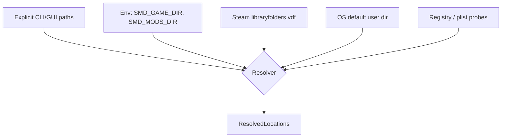
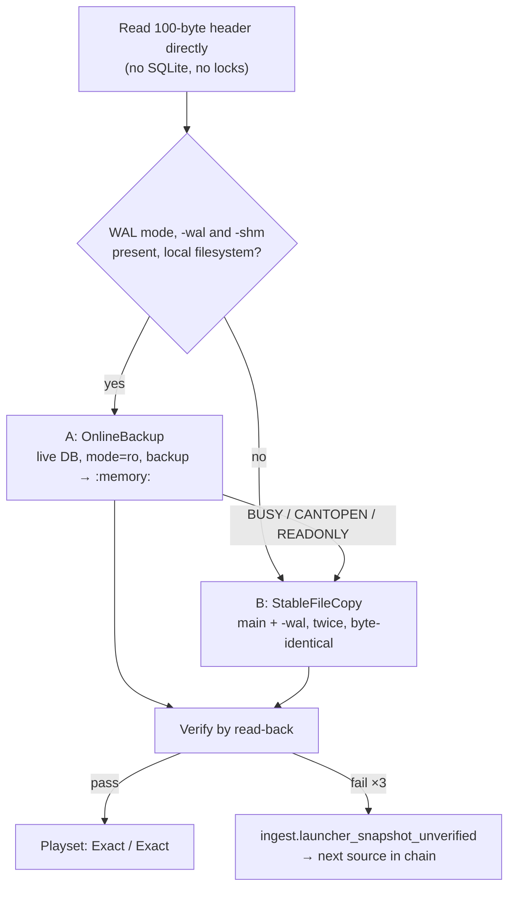

# 05 — Ingest: discovery, descriptors, load order

Everything before a single byte of mod *content* is read. This layer is where
platform-specific and Paradox-specific messiness is quarantined, so nothing downstream
has to know about `libraryfolders.vdf` or SQLite.

## Discovery



Sources are tried in that order; the first that yields an existing directory wins, and
the resolved set is shown in the UI so the user can see what was picked and override it.
Silent auto-detection that guesses wrong is worse than asking.

### Where things live

| Item | Windows | Linux | macOS |
| --- | --- | --- | --- |
| User mods | `%USERPROFILE%\Documents\Paradox Interactive\Stellaris\mod\` | `~/.local/share/Paradox Interactive/Stellaris/mod/` | `~/Documents/Paradox Interactive/Stellaris/mod/` |
| Workshop | `<lib>\steamapps\workshop\content\281990\` | same shape under the library root | same |
| Steam libraries | `steamapps\libraryfolders.vdf` under the Steam install | `~/.steam/steam/steamapps/libraryfolders.vdf` | `~/Library/Application Support/Steam/…` |
| Game install | `<lib>\steamapps\common\Stellaris\` | same | same |
| Launcher playsets | `…\Stellaris\launcher-v2.sqlite` | same dir | same |
| Legacy load order | `…\Stellaris\dlc_load.json` + `mods_registry.json` | same | same |

Proton/Wine installs put the "Documents" path inside a Wine prefix; the Linux resolver
probes `~/.steam/steam/steamapps/compatdata/281990/pfx/drive_c/users/steamuser/Documents/…`
as an additional candidate. Multiple Steam libraries are normal and all are scanned.

> These paths are the current best understanding and are encoded as **data** in
> `profiles/stellaris.toml`, not as code, precisely because Paradox has moved them
> before. See `docs/VERIFY.md` for the items to confirm against a live install.

### Steam library enumeration

`libraryfolders.vdf` is Valve's KeyValues format — close enough to Clausewitz script in
shape that `smd-syntax`'s lexer primitives are reused with a different token table
rather than pulling in a separate VDF crate.

## Enumeration and the stat cache

Enumeration walks the resolved roots with `ignore`'s `WalkBuilder::build_parallel` and
emits a `FileEntry` per file. The content hash on that entry is the key the parse cache
is addressed by — which means a warm scan that computes it the obvious way must re-read
and re-hash 1.2 GB to discover that it already had the answer. The 2 s warm target is
then unreachable by construction, not merely unmet.

So there are **two caches, and the stat cache sits in front**:

```
(volume_id, file_id, size, mtime_ns)  →  content_hash        stat cache   (smd-ingest)
 content_hash ‖ parser_id ‖ …         →  Vec<RawFact>        parse cache  (smd-parse, § 06)
```

| Field | Windows | Unix |
| --- | --- | --- |
| `volume_id` | `dwVolumeSerialNumber` | `st_dev` |
| `file_id` | `nFileIndexHigh/Low` (128-bit on ReFS) | `st_ino` |
| `size`, `mtime_ns` | from the same handle/`statx` call | same |

Rules that make it safe:

- **All four fields must match.** Identity alone is not enough — an in-place edit keeps
  the inode. Size and nanosecond mtime together are what make the entry trustworthy.
- A miss, a coarse mtime (some filesystems store seconds), or a clock that moved
  backwards means *hash it*. The stat cache may never be the reason a changed file is
  read as unchanged; it is an optimisation whose failure mode must be extra work.
- Entries are keyed by device and inode, not by path, so a mod moving between Steam
  libraries costs nothing.
- The walk already `stat`s every file to decide whether it is a directory, so the input
  is free. Only the lookup is new.

Vanilla's install tree is the largest and least volatile input, and it is the case this
layer exists for: after the first scan, hashing it again is pure waste.

The stat cache lives in the same SQLite file as the parse cache, one table, and is
written once per scan in a batch on the cache thread. Losing it is never a correctness
problem, so it is never fsynced and never blocks.

## Descriptors

Both `descriptor.mod` (inside the mod) and the launcher's `*.mod` (in `mod/`) are the
same KeyValues dialect:

```
name="Example Mod"
path="mod/example"                 # or archive="mod/example.zip"
remote_file_id="1234567890"
supported_version="3.13.*"
version="1.0"
tags={ "Gameplay" "Balance" }
dependencies={ "UI Overhaul Dynamic" }
replace_path="common/governments/civics"
```

```rust
pub struct Descriptor {
    pub name:              Box<str>,
    pub path:              Option<PathBuf>,
    pub archive:           Option<PathBuf>,
    pub remote_file_id:    Option<Box<str>>,
    pub version:           Option<Box<str>>,
    pub supported_version: Option<VersionPattern>,
    pub tags:              Vec<Box<str>>,
    pub dependencies:      Vec<Box<str>>,
    pub replace_paths:     Vec<Box<str>>,   // repeatable key
    pub source:            DescriptorSource, // Workshop | Local | Archive
}
```

Three details that bite implementations:

1. **`replace_path` repeats.** A mod may declare several. The parser must accumulate,
   not overwrite.
2. **Dependencies are matched by display name**, not by id, so matching must be
   normalised (trim, casefold, collapse whitespace) and is inherently fuzzy. Unmatched
   dependencies produce a `Warn`-level finding with the candidate list attached, never a
   confident "missing".
3. **`.mod` and `descriptor.mod` can disagree** (the launcher's copy goes stale). The
   launcher copy determines *whether and where* the mod loads; the inner copy is the
   author's intent. Both are captured; disagreement is itself a low-severity finding.

Zipped mods (`archive=`) are read through the same `VfsSource` trait as directories, so
nothing downstream knows the difference — and through the same boundary: the archive
reader enforces the entry-path, link, and size rules of § Trust boundaries before a byte
of an entry reaches a parser.

## Trust boundaries

Every byte below `ResolvedLocations` is **untrusted third-party data**: Workshop items
are arbitrary uploads, local mods are arbitrary directories, and archives are arbitrary
zips. The tool's job is to describe that data, so the boundary is not "reject the
strange" — strange is normal — but four properties that must hold whatever the input:

1. **No read escapes a resolved root**, and nothing is read that the user did not point
   the tool at (directly, or through a descriptor shown in the resolved-locations panel).
2. **Every resource is bounded**: no input can make a scan unbounded in time, memory, or
   disk, and every bound that trips is a *diagnostic plus an incompleteness*, never a
   silent drop (§ `06`, `Completeness`).
3. **Identity is unambiguous**: two files are the same file to the resolver only if the
   game would treat them as the same file, and where that is unknown the ambiguity is
   reported, not resolved by accident.
4. **Data never becomes markup or control**: names, paths, and content reach every output
   as text (§ `11`, Output safety).

Out of scope: an attacker who can already write to the user's config or cache directory.
That is the user's own trust domain, and the parse cache is keyed by content hash, so it
cannot be poisoned *by a mod*.

### Filesystem

| Hazard | Rule |
| --- | --- |
| Symlinks, junctions, mount points inside a root | **Not followed.** The walker runs with `follow_links(false)`; a link entry is not read, emits `fs.link_skipped` with its relative path, and a *file* link enters the overlay as `Unparsed(Refused)` (§ `03`). A *directory* link has no per-file records to carry that, so it makes its source **content-incomplete** instead (`ContentIncompleteReason::LinkRefused`, with the link's path; § `03`): it counts in `ScanCompleteness` and gaps every `Deleted` claim whose scope includes the link's path, exactly as `Unparsed(Refused)` would (gated H50, M1). Either way the game may well follow it, so its absence is a gap, not a fact. A *root* that is itself a link (a mod folder moved to another drive, a common user fix) is resolved once, canonicalised, and shown; only links *inside* roots are refused |
| Windows reparse points | Every entry is opened with `FILE_FLAG_OPEN_REPARSE_POINT` and its tag checked. Allowed tags are the ones that are still plain data (`DEDUP`, `WOF` compression). **Cloud placeholders** (`IO_REPARSE_TAG_CLOUD_*` — OneDrive redirecting `Documents`, which is where the user mod directory lives) are **not hydrated**: reading one triggers a download, which breaks the no-network rule and can stall for minutes. They are reported as `fs.cloud_placeholder`, and enter the overlay as `Unparsed(Refused)`. Every other tag is treated as a link |
| Check-then-open races | Type, identity, size, and mtime come from the **opened handle** (`fstat` / `GetFileInformationByHandle`), never from a prior `stat` of the path. On Linux the open is `openat2` with `RESOLVE_BENEATH \| RESOLVE_NO_SYMLINKS` where available, else per-component `O_NOFOLLOW` from the root fd; on Windows the handle's final path (`GetFinalPathNameByHandleW`) must lie under the root. A mismatch is `fs.escaped_root`, `Unparsed(Refused)` |
| Non-regular files | FIFOs, sockets, and devices are never opened — opening a FIFO blocks forever. Only regular files are read; others are `fs.special_skipped`, `Unparsed(Refused)` |
| Path traversal via descriptors | `path=` and `archive=` are resolved once against the documented base, canonicalised, and displayed. Refused (`ingest.root_refused`) if the result is a filesystem or volume root, the user's home directory itself, or an ancestor of the game install or of another root — a descriptor cannot turn "scan this mod" into "scan my disk". Mod-relative paths inside content are never joined onto a root: content is enumerated, not looked up by name |
| Case folding and Unicode | The identity key is § `03`'s normalisation (NFC, locale-independent lowercase, `/`). The **OS path used to open the file is the raw name from the directory entry**, carried beside the key and never reconstructed from it; `smd-fs` also populates `FileEntry::raw_name` (as shipped, NFC only) from the same entry, because the filename sort key for FIOS/LIOS directories is ordinal and case-sensitive (§ `03`). Two entries of one source whose keys collide (case or NFC variants — possible on ext4, case-sensitive APFS, and in zips) emit `fs.identity_collision`; both are kept and the resolver reports the path as `ResolutionGap::IdentityCollision` rather than picking one, because which one the game reads depends on the platform. Names that are not valid Unicode keep their raw `OsString`, take a lossy key, and emit `fs.unrepresentable_name` |
| Unbounded trees | Per source: ≤ 64 directory levels, ≤ 250 000 entries, ≤ 1 024-byte relative paths. Per content file: the § `06` cap (32 MB). Over a bound: `fs.limit_exceeded`; files over the file cap are `Unparsed(Oversize)`, entries beyond a tree bound are not enumerated and the source is content-incomplete (`Truncated`, with the path where the bound was hit; § `03`, § `06`) |

Every read goes through `smd-fs`'s root handle (§ `14`); there is no API that takes a bare
path and returns bytes.

### Archives (`archive=`)

Zipped mods are read **in place**, through a bounded reader, and never extracted to disk.

| Hazard | Rule |
| --- | --- |
| Entry paths | Normalise `\` to `/`. Refuse an entry with an absolute path, a drive or UNC prefix, a `..` or empty component, a NUL, or a name that differs between the central directory and its local header. Identity collisions are handled as on the filesystem |
| Link and special entries | Entries whose Unix mode is a symlink (or any non-regular type) are `archive.link_entry`, `Unparsed(Refused)` |
| Decompression bombs | Caps on **actually decompressed** bytes, counted while streaming — declared sizes are attacker-controlled: ≤ 32 MB per entry (the § `06` file cap), ≤ 2 GiB per archive, ≤ 100 000 entries, and a ratio cap of 200:1 for any entry above 1 MiB. Entries whose local-data ranges **overlap** in the central directory (the non-recursive overlapping bomb) refuse the archive |
| Nesting | An archive inside an archive is a file, not opened |
| Methods and encryption | Stored and Deflate are read. Other methods, and encrypted entries, are unread with a diagnostic |
| Malformed archives | Refused whole (`ingest.archive_refused`, with the reason): the source is inventoried, its content is unread and the source is content-incomplete (`ArchiveRefused`; `ArchiveUnread` while H23 is open; § `03`), and the report says so. Never a partial read that looks complete |

The reader is a fuzz target from the milestone that first opens an archive (§ `13`).

### Descriptor, metadata, and text limits

Small formats get small caps, because their real sizes are tiny and their parsers are
the first thing an adversarial file reaches:

| Input | Size cap | Other caps |
| --- | --- | --- |
| `descriptor.mod`, launcher `*.mod` | 64 KiB | value ≤ 4 KiB; ≤ 256 each of `tags`, `dependencies`, `replace_path`; depth ≤ 8 |
| `libraryfolders.vdf` | 1 MiB | depth ≤ 16; ≤ 64 libraries |
| `dlc_load.json`, `mods_registry.json`, `launcher-settings.json` | 16 MiB | `serde_json` recursion limit 64; ≤ 20 000 entries |
| `launcher-v2.sqlite` | 256 MiB before snapshotting into memory | — |
| Script and localisation content | 32 MB per file (§ `06`) | parser depth cap 256 (§ `06`) |

A descriptor over a cap is rejected with `ingest.descriptor_invalid`, and its mod is
inventoried under its directory name with content unread — not guessed at. Every string
taken from these files — names, tags, versions, dependency names — is stored verbatim,
control characters included, and is treated as display text that must be escaped at
every output (§ `11`).

The descriptor, VDF, and launcher-JSON readers are fuzz targets alongside the script
parser, under the same "never panics, never unbounded" guarantee (§ `13`).

## Load order

This is the single most consequential input, and the layer most likely to break when
Paradox ships a launcher update. It is therefore behind a trait with a fallback chain:

```rust
pub trait LoadOrderSource {
    fn id(&self) -> &'static str;
    /// The best this source can claim. A run may report less (an unverified snapshot
    /// never reports `Exact`), never more.
    fn ceiling(&self) -> (Confidence, Confidence);           // (order, activation)
    fn try_load(&self, loc: &ResolvedLocations) -> Result<Playset, OrderError>;
}
```

A source answers **two questions, and they fail independently**: *in what order* do the
mods load, and *which* mods load at all. The August design carried one confidence, and
the fallback built on it was wrong in the dangerous direction: `DirectoryScan` withheld
"who wins", but still treated every mod found on disk as enabled, so a user with 400
subscriptions and a 60-mod playset got 340 mods' worth of conflicts that cannot occur.
Order uncertainty suppresses a *verdict*; activation uncertainty changes whether the
finding exists at all. They are reported as two separate claims in
`PlaysetProvenance` (§ `03`), never folded into one.

| Impl | Order | Activation | Source |
| --- | --- | --- | --- |
| `LauncherV2Sqlite` | Exact | Exact | `launcher-v2.sqlite`, active playset, explicit positions and `enabled` flags — **only when the snapshot verified** (below); otherwise the chain falls through |
| `DlcLoadJson` | Inferred | Inferred | `dlc_load.json` order + `mods_registry.json` for names. Reflects the **last launch**, not the launcher's current state — exactly the state a user changes before asking why it crashed |
| `ExplicitFile` | Exact | Exact | A user-supplied order file (`--order order.txt`); the listed set *is* the enabled set. Provenance names it as user-asserted |
| `DirectoryScan` | Fallback | Fallback | Every mod found, `rank` empty, `activation == Unknown` for every source — **never `Active`** |

The chain tries in order and reports which one it used, with both certainties; `--order`,
when given, replaces the chain rather than taking its turn in it. What each level means
downstream:

| | Order | Activation |
| --- | --- | --- |
| `Exact` | Winners stated | Findings are definite (`ActivationCertainty::Certain`) |
| `Inferred` | Winners stated, badged as inferred | Findings are `Inferred` — never reported as `Certain` |
| `Fallback` | **All order-dependent rules suppressed**; collisions still reported | Every finding is `Conditional`: worded "*would* … if both are enabled", capped in severity, excluded from health aggregates (§ `09`). A `DirectoryScan` run with no findings is **not** a safe verdict, and the report says so |

The finding-level value is the worst over its participants (§ `03`, `Certainty`): all
`Active` from an `Exact` activation source is `Certain`; any participant from an
`Inferred` source makes it `Inferred`; any `Unknown` makes it `Conditional`. The resolver
consumes the same flag (§ `07`): an `Unknown` contender is never a stated winner, and a
winner is stated only if it is `Active` and outranks every `Unknown` contender.

Three consequences for ingest itself:

- **`Inactive` sources are inventoried, not indexed.** They appear in the playset view and
  in dependency resolution, and are never participants in a finding. That is what lets
  `dep.missing` say "*installed but disabled*" rather than "missing".
- **`Unknown` sources stay visible to the dependency resolver.** Under `DirectoryScan`,
  `dep.missing` can say "*not installed*" (definitive — discovery is complete over the
  resolved roots) or "*installed, enabled state unknown*" (`Conditional`), and nothing
  stronger.
- **Two sources that disagree are both reported.** If the launcher DB and `dlc_load.json`
  both read, and their enabled sets differ, the scan emits
  `ingest.activation_disagreement` listing the difference: the DB is what the launcher
  will launch *next*, `dlc_load.json` is what the game loaded *last* (assumed — `VERIFY.md`
  V08). The DB wins for activation; the user is shown which mods the two disagree on, because that difference is very often the answer to their question.

The `DirectoryScan` fallback is what keeps the tool useful when a launcher update breaks
the DB reader: same-path and symbol collisions are still detected, as conditional
findings, and only "who wins" and "is this real" are withheld. Degrading a feature beats
failing to start; degrading it *silently* does not, which is why the health strip shows
order and activation certainty as two badges, plus the snapshot method.

Within `smd-ingest`, `rusqlite` appears in exactly one module
(`smd-ingest::order::launcher_v2`). The only other user is the parse cache in
`smd-index` (§ `06` "Store and eviction"), which opens its own database and never the
launcher's.

### Snapshotting `launcher-v2.sqlite`

The launcher is expected to run in WAL mode (unverified — `VERIFY.md` V04), and the users most
likely to have it open are exactly the users about to ask why their game crashed. **Recent
commits — including the playset they just reordered — live in `launcher-v2.sqlite-wal`,
not in the main file.** A stale or torn read *returns no error*: a plausible playset, in
the wrong order, feeding every verdict the tool goes on to make. That is the worst failure
this design can have, so the read is specified rather than left to the obvious
implementation.

**What the August protocol got wrong** (REVIEW-2026-10 finding 6, confirmed). It copied
the main file, `-wal`, and `-shm` one after another and checked only the main file's
`(size, mtime)` before and after. A WAL-mode writer does not touch the main file on
commit — it appends to `-wal` — so the check could not see the writes it existed to
catch; a checkpoint mid-copy changes the main file and can then *reset* the WAL, so the
three copies can come from three different moments; and a copied `-shm` is an index into
a `-wal` that may no longer match it. File metadata is not evidence of a consistent
database. Only SQLite can say what SQLite committed.

**The protocol.** One principle: *consistency comes from a SQLite read transaction, and
verification reads the result back through SQLite.*



**Path A — `OnlineBackup`** (preferred):

1. Read the 100-byte header with an ordinary file read: the magic string, page size, and
   bytes 18–19 (`2` = WAL). This takes no lock and decides the path; it is not trusted for
   anything else.
2. Take path A only if the header says WAL, **`-wal` and `-shm` already exist** (the
   launcher has the DB open — so nothing is created beside the user's file), and the
   directory is on a local filesystem whose locks the launcher's SQLite also honours (see
   "never" below).
3. Open the **live** database as `file:…?mode=ro` with `SQLITE_OPEN_READONLY`, a 250 ms
   `busy_timeout`, and no other URI flags.
4. `sqlite3_backup_init` into a `:memory:` database and `sqlite3_backup_step(-1)` — the
   whole copy in **one step, so one read transaction**. SQLite's own isolation makes that
   a transaction-consistent snapshot: every page as of one commit, WAL included. In WAL
   mode a reader does not block the launcher's writer; the cost to the launcher is that a
   checkpoint cannot reset the WAL for the few milliseconds the read holds its snapshot.
   (`VACUUM INTO` gives the same guarantee and is the fallback if the backup API is
   unavailable in the binding.)
5. Close the live connection. Everything after this reads the in-memory snapshot.

**Path B — `StableFileCopy`** (when A is not allowed or refused):

1. Copy the main file and `-wal` (if present) into a private `0700` temp directory.
   **Never `-shm`**: it is a derived index, SQLite rebuilds it from `-wal`, and a copied
   one is the inconsistent part.
2. Copy both again, and hash both passes with `blake3`. Accept only if the two passes are
   **byte-identical**. A write, checkpoint, or WAL reset during the first pass changes
   some file between the passes; two identical passes bracket an interval with no write.
   Retry up to three times with 200 ms backoff.
3. Open the private copy **read-write** (it is ours) so SQLite runs WAL recovery against
   it and rebuilds the index; WAL frame checksums mean a torn trailing frame is discarded
   as uncommitted, not read. Then back it up into `:memory:` exactly as in A.4, and delete
   the temp directory on every exit path.

**Verification — both paths, by read-back, never by metadata:**

1. `PRAGMA integrity_check` on the snapshot (not `quick_check`: the DB is a few MB and the
   full check also validates index ↔ table agreement, which is where a torn page hides).
2. Schema probe against the table and column set confirmed for the current
   launcher in `VERIFY.md`: the playset, mod, and join tables, the active-playset marker,
   `position`, and `enabled`, including `position`'s type, which has changed across
   launcher versions. A missing or retyped column is `ingest.launcher_schema_unknown`
   carrying the tables and columns actually found.
3. Read the active playset and compute a **logical digest** — `blake3` over the
   `(playset id, mod id, position, enabled)` rows in a fixed order, plus the active-playset
   id.
4. *Path A only:* compute the same digest in a fresh read transaction on the live DB. Equal
   means the snapshot is also the current state. Unequal means the launcher committed in
   between: take a new snapshot, up to three times; if the digest is still moving, use the
   latest snapshot and emit `ingest.launcher_changing` — the order is consistent but may
   be seconds stale, and the user is told to rescan once the launcher is idle.
5. Data invariants the schema cannot express: exactly one active, non-removed playset
   (no source guarantees it — more than one is `ingest.launcher_multiple_active`, and the
   reader does not choose); positions unique within it; every `modId` resolves to a `mods`
   row. Booleans are not type-assumed (`0`/`1` and `'true'`/`'false'` are accepted, anything
   else is schema-unknown), and `position` is accepted as an integer or as the older
   zero-padded 10-character string. An absent `isRemoved` column means the older schema,
   not an error. A violation is a refusal, not a repair.

Any failure in 1–5 after the retries: the chain falls through to the next source and the
report leads with `ingest.launcher_snapshot_unverified`, naming the step that failed, the
launcher build, and the path taken. An unverified snapshot never yields `Exact`.

**Verified vs assumed.** The protocol's claims, stated with their basis:

| Claim | Status |
| --- | --- |
| Snapshot is transaction-consistent | **Verified at runtime** by SQLite's isolation (A) or by two byte-identical passes plus WAL recovery (B) — *given* the assumptions below |
| Snapshot is structurally sound | **Verified at runtime**: `integrity_check` + data invariants |
| Snapshot is the launcher's current state | **Verified at runtime** on path A (live digest); path B verifies only that nothing wrote across the copy window |
| Schema means what the reader thinks (`enabled`, active marker, `position` direction) | **Assumed** — single source (Irony's models, which predate the 4.5 launcher); table names V03, active marker and `enabled` semantics V41, migration marker V06; evidence gate H43. The probe *detects* a changed schema; it cannot detect a column whose meaning changed |
| Launcher uses stock SQLite locking (no `locking_mode=EXCLUSIVE`, no custom VFS) | **Assumed** (V40, H48). An exclusive launcher makes path A return `SQLITE_BUSY` and forces path B, which still verifies; nothing is silently wrong |
| Launcher DB is WAL | **Assumed** (V04, H48). If not, path B is taken automatically — in rollback-journal mode even a reader's `SHARED` lock can make a launcher commit fail, so path A is never used there |
| Windows share modes permit the copy | **Assumed** (V05, H48). If not, both paths fail loudly and the chain falls through |
| What the launcher DB says is what the game loads | **Assumed** (V08) — the game reads `dlc_load.json` written at Play time; hence `ingest.activation_disagreement` |

| Never | Why |
| --- | --- |
| `immutable=1` on the live DB | Tells SQLite the file cannot change, so it skips locking and *ignores the WAL entirely*. Silently reads the pre-WAL state. (Harmless on a file the tool wrote and closed itself — and pointless, because the snapshot is in memory.) |
| `nolock=1` | Suppresses the locking protocol against a database another process is writing. Torn pages, no error |
| Path A across an interop boundary | WSL reading `/mnt/c/…` (drvfs/9p), a Proton prefix read from a host process using a different SQLite, SMB/NFS: POSIX and Windows locks do not see each other, so SQLite's isolation guarantee does not hold. Detected from the mount type; path B only |
| Copying `-shm` | Derived state; the one file whose copy can be inconsistent with the others while every byte of it is valid |
| Checking file metadata as evidence of consistency | What the August protocol did. A WAL commit does not change the main file's size or mtime |
| Writing to the user's main file or `-wal` | Path A opens read-only; path B reads only. Path A's reader updates lock bytes in the existing `-shm`, as every SQLite reader does — the only write the tool makes near the launcher's files, and the reason path A requires `-shm` to exist already |
| Guessing past a failed check | A corrupt page yields *some* rows. Refusing is the only honest answer |

**Failures are loud.** A launcher update that quietly demotes every user to `DlcLoadJson`
or `DirectoryScan` while the UI still looks fine is a bug that would take months to
notice; the named diagnostic and the two certainty badges make it a visible banner, which
is what makes it a one-day fix instead. Gate **H20** (§ Gates below).

### Precedence model

Load-order position is **not** the source's identity. `SourceId` is assigned in discovery
order and means nothing else; precedence is `SourceMeta.rank` within the precedence tuple,
and comparison must route through it. `SourceMeta`, `Activation`, and `PlaysetProvenance`
are defined once, in § `03`; this document deliberately does not repeat the struct, so
the two cannot drift.

`rank` is a vector rather than an integer so that a reorder can insert between two
existing sources without renumbering — the sandbox (§ `11`) depends on that. Filename
precedence *within* a directory is a separate component of the precedence tuple, not a
`rank` extension (§ `03`, § `07`).

The "later wins" convention is recorded in `profiles/stellaris.toml` as
`load_order.later_wins = true`, because it is a *game* fact rather than a universal one,
and the second game profile added will be the test of whether that assumption was
correctly isolated. Its status is tracked in `VERIFY.md`; everything in the tool keys off
it.

## Version matching

```rust
pub struct VersionPattern(Vec<Component>);   // Component = Exact(u16) | Wildcard

impl VersionPattern {
    pub fn matches(&self, v: &GameVersion) -> Match  // Yes | No | Unknown
}
```

- `3.13.*` vs `4.0.3` → `No`
- `4.*` vs `4.0.3` → `Yes`
- `4.0.*` vs `4.0.3` → `Yes`
- absent or unparseable → `Unknown` (never `No` — an unset field is not a claim)

The installed version is read from the game directory's `launcher-settings.json` /
`.exe` metadata where available, and is overridable with `--game-version`. Version drift
is scored **low on its own** — a mod one patch behind usually still works, and a tool
that shouts about every out-of-date `supported_version` gets ignored. It is scored
higher only in combination with other findings for the same mod.

## Gates (REVIEW-2026-10)

| Gate | Closes when | Milestone |
| --- | --- | --- |
| **H20** | Snapshot protocol (§ Snapshotting) implemented with both paths and read-back verification, and exercised against a live, just-reordered launcher on Windows and Linux. Fixtures: a DB whose latest playset commit exists only in `-wal` must come back with that commit on both paths; a copy torn by a concurrent writer must fail path B's double-pass check; a corrupted page must fail `integrity_check` and fall through | M1; depends on H43, H48 |
| **H21** | Order and activation certainty reported separately end to end; a test proves `DirectoryScan` yields no `Active` source and no `Certain` finding, and that `Inactive` sources are never participants | M1 |
| **H22** | Filesystem boundary: adversarial fixture tree (symlink and junction escapes, FIFO, case and NFC collisions, invalid-Unicode names, over-limit tree) produces exactly the listed diagnostics and no read outside a root | M1 |
| **H23** | Archive boundary: fixture set (traversal entries, symlink entries, overlapping and ratio bombs, lying sizes, CD/local-header mismatch) plus the archive fuzz target. Until it closes, `archive=` mods are inventoried with content unread and a completeness warning | M1 (inventory-only), before any archive content is read |
| **H24** | Descriptor / VDF / launcher-JSON caps enforced; each reader is a fuzz target | M1 |
| **H29** | "Launcher files untouched": with the launcher open and closed, main file and `-wal` are byte-identical before and after a read on both paths, and no file is created beside them | M1 (needs a live install; depends on H43, H48) |

H25–H28 (output safety, redaction, GUI/HTML rendering, `serve`) are in § `11`.
