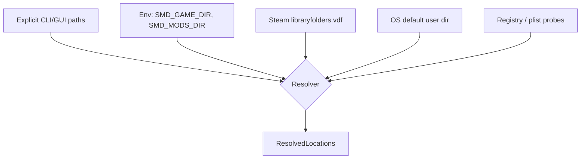

# 05 — Ingest: discovery, descriptors, load order

Everything before a single byte of mod *content* is read. This layer is where
platform-specific and Paradox-specific messiness is quarantined, so nothing downstream
has to know about `libraryfolders.vdf` or SQLite.

## Discovery



Sources are tried in that order; the first that yields an existing directory wins, and
the resolved set is shown in the UI so the user can see what was picked and override it.
Silent auto-detection that guesses wrong is worse than asking.

### Where things live

| Item | Windows | Linux | macOS |
| --- | --- | --- | --- |
| User mods | `%USERPROFILE%\Documents\Paradox Interactive\Stellaris\mod\` | `~/.local/share/Paradox Interactive/Stellaris/mod/` | `~/Documents/Paradox Interactive/Stellaris/mod/` |
| Workshop | `<lib>\steamapps\workshop\content\281990\` | same shape under the library root | same |
| Steam libraries | `steamapps\libraryfolders.vdf` under the Steam install | `~/.steam/steam/steamapps/libraryfolders.vdf` | `~/Library/Application Support/Steam/…` |
| Game install | `<lib>\steamapps\common\Stellaris\` | same | same |
| Launcher playsets | `…\Stellaris\launcher-v2.sqlite` | same dir | same |
| Legacy load order | `…\Stellaris\dlc_load.json` + `mods_registry.json` | same | same |

Proton/Wine installs put the "Documents" path inside a Wine prefix; the Linux resolver
probes `~/.steam/steam/steamapps/compatdata/281990/pfx/drive_c/users/steamuser/Documents/…`
as an additional candidate. Multiple Steam libraries are normal and all are scanned.

> These paths are the current best understanding and are encoded as **data** in
> `profiles/stellaris.toml`, not as code, precisely because Paradox has moved them
> before. See `docs/VERIFY.md` for the items to confirm against a live install.

### Steam library enumeration

`libraryfolders.vdf` is Valve's KeyValues format — close enough to Clausewitz script in
shape that `smd-syntax`'s lexer primitives are reused with a different token table
rather than pulling in a separate VDF crate.

## Enumeration and the stat cache

Enumeration walks the resolved roots with `ignore`'s `WalkBuilder::build_parallel` and
emits a `FileEntry` per file. The content hash on that entry is the key the parse cache
is addressed by — which means a warm scan that computes it the obvious way must re-read
and re-hash 1.2 GB to discover that it already had the answer. The 2 s warm target is
then unreachable by construction, not merely unmet.

So there are **two caches, and the stat cache sits in front**:

```
(volume_id, file_id, size, mtime_ns)  →  content_hash        stat cache   (smd-ingest)
 content_hash ‖ parser_id ‖ …         →  Vec<RawFact>        parse cache  (smd-parse, § 06)
```

| Field | Windows | Unix |
| --- | --- | --- |
| `volume_id` | `dwVolumeSerialNumber` | `st_dev` |
| `file_id` | `nFileIndexHigh/Low` (128-bit on ReFS) | `st_ino` |
| `size`, `mtime_ns` | from the same handle/`statx` call | same |

Rules that make it safe:

- **All four fields must match.** Identity alone is not enough — an in-place edit keeps
  the inode. Size and nanosecond mtime together are what make the entry trustworthy.
- A miss, a coarse mtime (some filesystems store seconds), or a clock that moved
  backwards means *hash it*. The stat cache may never be the reason a changed file is
  read as unchanged; it is an optimisation whose failure mode must be extra work.
- Entries are keyed by device and inode, not by path, so a mod moving between Steam
  libraries costs nothing.
- The walk already `stat`s every file to decide whether it is a directory, so the input
  is free. Only the lookup is new.

Vanilla's install tree is the largest and least volatile input, and it is the case this
layer exists for: after the first scan, hashing it again is pure waste.

The stat cache lives in the same SQLite file as the parse cache, one table, and is
written once per scan in a batch on the cache thread. Losing it is never a correctness
problem, so it is never fsynced and never blocks.

## Descriptors

Both `descriptor.mod` (inside the mod) and the launcher's `*.mod` (in `mod/`) are the
same KeyValues dialect:

```
name="Example Mod"
path="mod/example"                 # or archive="mod/example.zip"
remote_file_id="1234567890"
supported_version="3.13.*"
version="1.0"
tags={ "Gameplay" "Balance" }
dependencies={ "UI Overhaul Dynamic" }
replace_path="common/governments/civics"
```

```rust
pub struct Descriptor {
    pub name:              Box<str>,
    pub path:              Option<PathBuf>,
    pub archive:           Option<PathBuf>,
    pub remote_file_id:    Option<Box<str>>,
    pub version:           Option<Box<str>>,
    pub supported_version: Option<VersionPattern>,
    pub tags:              Vec<Box<str>>,
    pub dependencies:      Vec<Box<str>>,
    pub replace_paths:     Vec<Box<str>>,   // repeatable key
    pub source:            DescriptorSource, // Workshop | Local | Archive
}
```

Three details that bite implementations:

1. **`replace_path` repeats.** A mod may declare several. The parser must accumulate,
   not overwrite.
2. **Dependencies are matched by display name**, not by id, so matching must be
   normalised (trim, casefold, collapse whitespace) and is inherently fuzzy. Unmatched
   dependencies produce a `Warn`-level finding with the candidate list attached, never a
   confident "missing".
3. **`.mod` and `descriptor.mod` can disagree** (the launcher's copy goes stale). The
   launcher copy determines *whether and where* the mod loads; the inner copy is the
   author's intent. Both are captured; disagreement is itself a low-severity finding.

Zipped mods (`archive=`) are read through the same `VfsSource` trait as directories, so
nothing downstream knows the difference.

## Load order

This is the single most consequential input, and the layer most likely to break when
Paradox ships a launcher update. It is therefore behind a trait with a fallback chain:

```rust
pub trait LoadOrderSource {
    fn id(&self) -> &'static str;
    fn confidence(&self) -> Confidence;                     // Exact | Inferred | Fallback
    fn try_load(&self, loc: &ResolvedLocations) -> Result<Playset, OrderError>;
}
```

| Impl | Confidence | Source |
| --- | --- | --- |
| `LauncherV2Sqlite` | Exact | `launcher-v2.sqlite`, active playset with explicit positions |
| `DlcLoadJson` | Inferred | `dlc_load.json` order + `mods_registry.json` for names |
| `ExplicitFile` | Exact | A user-supplied order file (`--order order.txt`) |
| `DirectoryScan` | Fallback | Every mod found, ordered by name; **all order-dependent rules are suppressed** |

The chain tries in order and reports which one it used. The `DirectoryScan` fallback is
what keeps the tool useful when a launcher update breaks the DB reader: file-level and
symbol-level collisions are still detected, only "who wins" is withheld. Degrading a
feature beats failing to start.

`rusqlite` appears in exactly one module (`smd-ingest::order::launcher_v2`).

### Reading `launcher-v2.sqlite` while the launcher is open

The launcher runs in WAL mode, and the users most likely to have it open are exactly the
users about to ask why their game crashed. **Recent commits — including the playset they
just reordered — live in `launcher-v2.sqlite-wal`, not in the main file.** Copying only
the main file therefore yields a stale or torn read *and returns no error*: a plausible
playset, in the wrong order, feeding every verdict the tool goes on to make. That is the
worst failure this design can have, so the read is specified rather than left to the
obvious implementation.

1. `stat` the main DB; record `(size, mtime_ns)`.
2. Copy **`launcher-v2.sqlite`, `-wal`, and `-shm` together** into a private temp
   directory. All three, always — the `-wal` carries the recent commits and the `-shm` is
   the index into it.
3. `stat` again. If size or mtime moved, the copy may be torn: discard and retry, up to
   three times, then report the source as unavailable.
4. Open the **copy** read-only (`file:…?mode=ro`) and let SQLite recover the WAL on first
   read. Recovery happens against the copy; the user's database is never touched.
5. `PRAGMA quick_check`, then probe the schema for the tables and the position column the
   reader depends on.
6. Delete the temp copy when the read completes or fails.

| Never | Why |
| --- | --- |
| `immutable=1` | Tells SQLite the file cannot change, so it *ignores the WAL entirely*. Silently reads the pre-WAL state. |
| `nolock=1` | Suppresses the locking protocol against a database another process is writing. Torn pages, no error. |
| Reading the original in place | A read that acquires locks on a live launcher DB is a read that can block the launcher. |
| Guessing past a failed `quick_check` | A corrupt page yields *some* rows. Refusing is the only honest answer. |

**Failures are loud.** If `quick_check` fails, or the schema does not match what the
reader expects, the chain still falls through to the next source — but the report leads
with a named diagnostic (`ingest.launcher_schema_unknown`) carrying the launcher build
and the tables actually found, and the load-order confidence drops to `Fallback` in the
health strip. A launcher update that quietly demotes every user to `DirectoryScan` while
the UI still looks fine is a bug that would take months to notice; making it a visible
banner is what makes it a one-day fix instead.

### Precedence model

Load-order position is **not** the source's identity. `SourceId` is assigned in discovery
order and means nothing else; precedence is `SourceMeta.rank`, and comparison must route
through it (§ `03`).

```rust
pub struct SourceMeta {
    pub key:              ModKey,
    pub name:             Box<str>,
    pub rank:             Vec<u32>,     // precedence; lexicographic. Vanilla is [0].
    pub enabled:          bool,
    pub role:             SourceRole,   // Vanilla | Dlc | Mod
    pub order_confidence: Confidence,   // from the LoadOrderSource that produced it
    pub deps:             Vec<ResolvedDependency>,
}
```

`rank` is a vector rather than an integer so that a reorder can insert between two
existing sources without renumbering — the sandbox (§ `11`) depends on that, and so does
any future intra-source ordering rule (the `00_`/`zz_` filename convention, unmodelled in
v1 and listed in `VERIFY.md`).

The "later wins" convention is recorded in `profiles/stellaris.toml` as
`load_order.later_wins = true`, because it is a *game* fact rather than a universal one,
and the second game profile added will be the test of whether that assumption was
correctly isolated. It is unverified until M0.5 closes the first item in `VERIFY.md`;
everything in the tool keys off it.

## Version matching

```rust
pub struct VersionPattern(Vec<Component>);   // Component = Exact(u16) | Wildcard

impl VersionPattern {
    pub fn matches(&self, v: &GameVersion) -> Match  // Yes | No | Unknown
}
```

- `3.13.*` vs `4.0.3` → `No`
- `4.*` vs `4.0.3` → `Yes`
- `4.0.*` vs `4.0.3` → `Yes`
- absent or unparseable → `Unknown` (never `No` — an unset field is not a claim)

The installed version is read from the game directory's `launcher-settings.json` /
`.exe` metadata where available, and is overridable with `--game-version`. Version drift
is scored **low on its own** — a mod one patch behind usually still works, and a tool
that shouts about every out-of-date `supported_version` gets ignored. It is scored
higher only in combination with other findings for the same mod.
