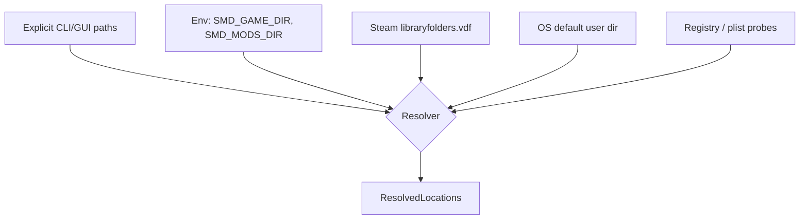

# 05 — Ingest: discovery, descriptors, load order

Everything before a single byte of mod *content* is read. This layer is where
platform-specific and Paradox-specific messiness is quarantined, so nothing downstream
has to know about `libraryfolders.vdf` or SQLite.

## Discovery



Sources are tried in that order; the first that yields an existing directory wins, and
the resolved set is shown in the UI so the user can see what was picked and override it.
Silent auto-detection that guesses wrong is worse than asking.

### Where things live

| Item | Windows | Linux | macOS |
| --- | --- | --- | --- |
| User mods | `%USERPROFILE%\Documents\Paradox Interactive\Stellaris\mod\` | `~/.local/share/Paradox Interactive/Stellaris/mod/` | `~/Documents/Paradox Interactive/Stellaris/mod/` |
| Workshop | `<lib>\steamapps\workshop\content\281990\` | same shape under the library root | same |
| Steam libraries | `steamapps\libraryfolders.vdf` under the Steam install | `~/.steam/steam/steamapps/libraryfolders.vdf` | `~/Library/Application Support/Steam/…` |
| Game install | `<lib>\steamapps\common\Stellaris\` | same | same |
| Launcher playsets | `…\Stellaris\launcher-v2.sqlite` | same dir | same |
| Legacy load order | `…\Stellaris\dlc_load.json` + `mods_registry.json` | same | same |

Proton/Wine installs put the "Documents" path inside a Wine prefix; the Linux resolver
probes `~/.steam/steam/steamapps/compatdata/281990/pfx/drive_c/users/steamuser/Documents/…`
as an additional candidate. Multiple Steam libraries are normal and all are scanned.

> These paths are the current best understanding and are encoded as **data** in
> `profiles/stellaris.toml`, not as code, precisely because Paradox has moved them
> before. See `docs/VERIFY.md` for the items to confirm against a live install.

### Steam library enumeration

`libraryfolders.vdf` is Valve's KeyValues format — close enough to Clausewitz script in
shape that `smd-syntax`'s lexer primitives are reused with a different token table
rather than pulling in a separate VDF crate.

## Descriptors

Both `descriptor.mod` (inside the mod) and the launcher's `*.mod` (in `mod/`) are the
same KeyValues dialect:

```
name="Example Mod"
path="mod/example"                 # or archive="mod/example.zip"
remote_file_id="1234567890"
supported_version="3.13.*"
version="1.0"
tags={ "Gameplay" "Balance" }
dependencies={ "UI Overhaul Dynamic" }
replace_path="common/governments/civics"
```

```rust
pub struct Descriptor {
    pub name:              Box<str>,
    pub path:              Option<PathBuf>,
    pub archive:           Option<PathBuf>,
    pub remote_file_id:    Option<Box<str>>,
    pub version:           Option<Box<str>>,
    pub supported_version: Option<VersionPattern>,
    pub tags:              Vec<Box<str>>,
    pub dependencies:      Vec<Box<str>>,
    pub replace_paths:     Vec<Box<str>>,   // repeatable key
    pub source:            DescriptorSource, // Workshop | Local | Archive
}
```

Three details that bite implementations:

1. **`replace_path` repeats.** A mod may declare several. The parser must accumulate,
   not overwrite.
2. **Dependencies are matched by display name**, not by id, so matching must be
   normalised (trim, casefold, collapse whitespace) and is inherently fuzzy. Unmatched
   dependencies produce a `Warn`-level finding with the candidate list attached, never a
   confident "missing".
3. **`.mod` and `descriptor.mod` can disagree** (the launcher's copy goes stale). The
   launcher copy determines *whether and where* the mod loads; the inner copy is the
   author's intent. Both are captured; disagreement is itself a low-severity finding.

Zipped mods (`archive=`) are read through the same `VfsSource` trait as directories, so
nothing downstream knows the difference.

## Load order

This is the single most consequential input, and the layer most likely to break when
Paradox ships a launcher update. It is therefore behind a trait with a fallback chain:

```rust
pub trait LoadOrderSource {
    fn id(&self) -> &'static str;
    fn confidence(&self) -> Confidence;                     // Exact | Inferred | Fallback
    fn try_load(&self, loc: &ResolvedLocations) -> Result<Playset, OrderError>;
}
```

| Impl | Confidence | Source |
| --- | --- | --- |
| `LauncherV2Sqlite` | Exact | `launcher-v2.sqlite`, active playset with explicit positions |
| `DlcLoadJson` | Inferred | `dlc_load.json` order + `mods_registry.json` for names |
| `ExplicitFile` | Exact | A user-supplied order file (`--order order.txt`) |
| `DirectoryScan` | Fallback | Every mod found, ordered by name; **all order-dependent rules are suppressed** |

The chain tries in order and reports which one it used. The `DirectoryScan` fallback is
what keeps the tool useful when a launcher update breaks the DB reader: file-level and
symbol-level collisions are still detected, only "who wins" is withheld. Degrading a
feature beats failing to start.

`rusqlite` appears in exactly one module (`smd-ingest::order::launcher_v2`). If the DB
is locked because the launcher is open, it is copied to a temp file and read from there.

### Precedence model

```rust
/// Later in the playset = higher precedence. Vanilla is SourceId(0).
fn assign_source_ids(playset: &Playset) -> Vec<SourceId>
```

The "later wins" convention is recorded in `profiles/stellaris.toml` as
`load_order.later_wins = true`, because it is a *game* fact rather than a universal one,
and the second game profile added will be the test of whether that assumption was
correctly isolated.

## Version matching

```rust
pub struct VersionPattern(Vec<Component>);   // Component = Exact(u16) | Wildcard

impl VersionPattern {
    pub fn matches(&self, v: &GameVersion) -> Match  // Yes | No | Unknown
}
```

- `3.13.*` vs `4.0.3` → `No`
- `4.*` vs `4.0.3` → `Yes`
- `4.0.*` vs `4.0.3` → `Yes`
- absent or unparseable → `Unknown` (never `No` — an unset field is not a claim)

The installed version is read from the game directory's `launcher-settings.json` /
`.exe` metadata where available, and is overridable with `--game-version`. Version drift
is scored **low on its own** — a mod one patch behind usually still works, and a tool
that shouts about every out-of-date `supported_version` gets ignored. It is scored
higher only in combination with other findings for the same mod.
